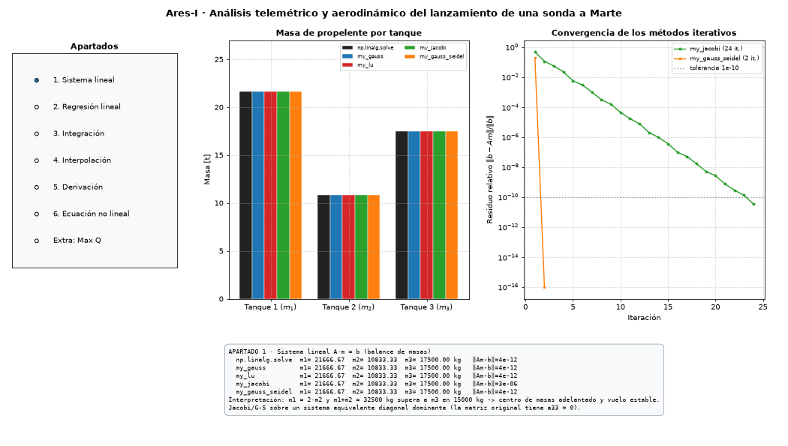

# Ares-I · Análisis telemétrico y aerodinámico del lanzamiento de una sonda a Marte

Proyecto de **Programación – Grado en Ingeniería Aeroespacial** (presentación oral, enunciado 6).
Integrantes: Pablo Ruiz, Jon Recio, Beltrán Rodriguez, Fausto Rapisardi

Dashboard interactivo en `matplotlib` que procesa la telemetría del vehículo Ares-I con métodos numéricos.
Cada apartado se resuelve **primero con numpy** y **después con las funciones propias `my_`** de la
biblioteca `my_numerical_lib.py`, comparando el resultado y el error frente a la solución exacta.



## Ejecución

```bash
pip install -r requirements.txt
python main.py
```

Se imprime un informe por consola y se abre una única ventana interactiva:
menú `RadioButtons` (apartados 1–6 + extra), panel de resultados numéricos y `Slider` de
velocidad diana (300–1000 m/s) en el Apartado 6.

## Estructura

| Fichero | Contenido |
|---|---|
| `main.py` | Datos del enunciado · un `def resolver_apartado_X` por apartado · informe por consola · GUI |
| `my_numerical_lib.py` | Biblioteca propia de métodos numéricos (funciones `my_`) |

## Métodos por apartado

| Apartado | numpy | Funciones propias | Resultado |
|---|---|---|---|
| 1. Sistema lineal (masas de propelente) | `np.linalg.solve` | `my_gauss`, `my_lu`, `my_jacobi`, `my_gauss_seidel` | m = 21 666.7 / 10 833.3 / 17 500 kg |
| 2. Regresión lineal (sensor Pitot) | `np.polyfit` | `my_linear_regression` | P = 21.11·V − 0.28 kPa (R² = 0.9999) |
| 3. Integración (altitud) | `np.trapezoid` | `my_trapecio`, `my_simpson`, `my_trapecio_acumulado` | h(120 s) = 135.84 km |
| 4. Interpolación (densidad) | `np.interp`, `np.polyfit` (Lagrange) | `my_interp_lineal`, `my_vandermonde`, `my_lagrange` | ρ(t) |
| 5. Derivación (aceleración) | `np.gradient` (extremos de 2.º y de 1.er orden) | `my_derivada_centrada`, `my_derivada_adelantada`, `my_derivada_retrasada` (3 puntos), `my_derivada_numerica` | a_max = 31.24 m/s² = 3.19 g |
| 6. Ecuación no lineal (Mach 1) | cambio de signo vectorizado | `my_newton`, `my_biseccion` | t_crit = 30.10 s |
| Extra | — | — | Max Q = 78.6 kPa en t = 43 s |
